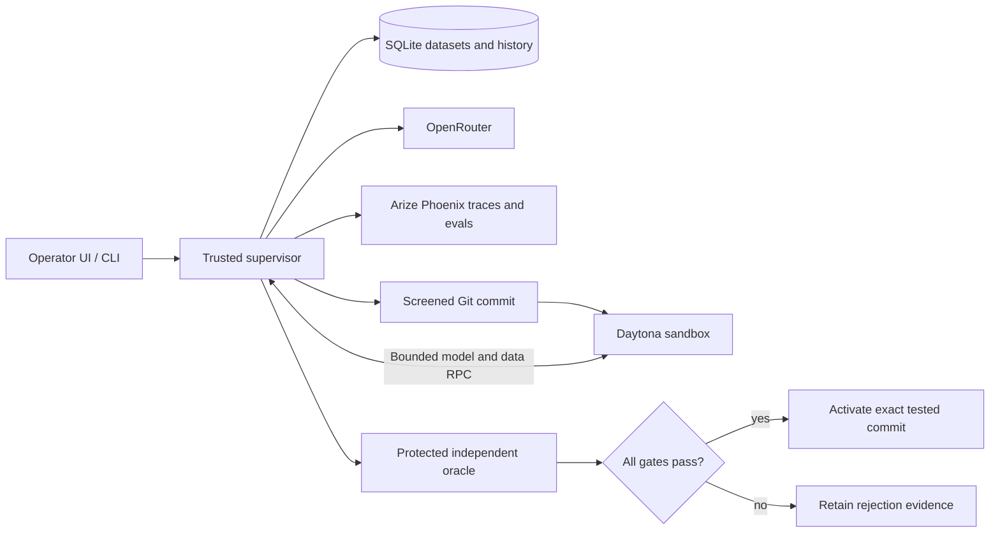

# SEAL

**An agent harness that repairs its tools, tests the change in Daytona, and promotes it only when independent evaluations pass.**

SEAL turns a reproducible agent failure into a versioned harness patch. Arize Phoenix records model/tool traces, deterministic correctness scores, and paired baseline/candidate experiments. Daytona executes generated code in isolated sandboxes. SQLite stores immutable datasets and the compact evidence needed to reproduce every decision.

## Start

Requires Python 3.11+, uv, Git, a Daytona account, Arize Phoenix (Cloud or local), and OpenRouter models with tool calling. Commands automatically load the ignored `.env` in the current directory.

```sh
uv sync --frozen --extra dev
cp .env.example .env  # Skip if you already configured .env.
# Fill in model, Daytona, and Phoenix settings.
uv run seal doctor
uv run seal runner build
uv run seal seed --fixture evals/analyst/data/small_inventory.json
uv run seal seed-logistics
uv run seal ui
```

Open http://127.0.0.1:4173. Ask an inventory question or the public logistics question: **How many customers sent more than 15 shipments from warehouse 3 yesterday?** The reviewed logistics tool returns **2**. The fixture uses synthetic reporting dates.

Phoenix Cloud URLs must include your app handle: `https://app.phoenix.arize.com/s/YOUR_APP_HANDLE`. The root Cloud URL is not a collector or API endpoint. Local Phoenix works at `http://localhost:6006` with no API key.

## Demonstrate a repair

The small inventory case fits the initial tools. The 512-row grouped case exposes the base harness's bounded model loop. Run it, then evolve the recorded limitation:

```sh
uv run seal eval run --scenario small-east-available
uv run seal eval run --scenario bulk-warehouse-available
uv run seal evolve --run-id RUN_ID_FROM_PREVIOUS_OUTPUT
```

Evolution diagnoses the Phoenix trace, independently reproduces the failure, requests a reusable patch from the evolution model, screens its diff, and evaluates pinned baseline/candidate commits in Daytona. It compares the original failure, a generated failure case, regressions, fresh private variations, and an unrelated refusal. Only a candidate that satisfies every gate becomes active. Subsequent UI/CLI runs use that exact commit.

`eval run` exits successfully when the declared **baseline expectation** matches, including an expected failure. Read `passed`, `violation`, and `baseline_expectation_matched` separately. A rejected candidate is an honest result, never a successful repair. Keep reviewed source changes committed before evolution.

One command runs the public failure-to-repair flow:

```sh
uv run seal demo
```

Live evolution consumes model credits and creates temporary Daytona sandboxes. Generated repairs are hypotheses; acceptance is not guaranteed. Scores and traces appear in the configured Phoenix project. Baseline and candidate experiments share the same frozen Phoenix dataset.

## Architecture



Candidates receive the editable `harness/`, minimal runtime shims, the assigned task, and a bounded supervisor bridge. They receive no provider credentials, database file, repository history, oracle, expected answers, or private manifests. Daytona blocks outbound networking; candidate processes run as an unprivileged user with read-only staged code and resource limits. Each trial uses a fresh sandbox, deleted in `finally`, with TTL and automatic deletion as backup. A cleanup failure makes the run fail.

Phoenix stores redacted execution traces and CODE evaluations; SQLite retains local decision evidence and remote experiment IDs. Trace retrieval and evaluation publication must succeed for live evolution to proceed. Tracing failures preserve an ordinary run's measured answer but cannot count as complete promotion evidence.

## Verify

```sh
uv run --frozen pytest -q
cd ui && npm ci && npm test
```

Credential-free tests use real SQLite databases, actual isolated runtime processes through a test-only transport, OpenTelemetry's in-memory exporter, and Daytona/Phoenix API test doubles. They verify mechanics, not cloud isolation. Run the real Daytona bridge separately:

```sh
uv run python scripts/live_smoke.py
```

For a stronger final claim, reserve untouched cases **before** evolution and assess the accepted commit once:

```sh
uv run seal final reserve --manifest /tmp/seal-final.json
# Run the failure and evolution flow.
uv run seal final assess --manifest /tmp/seal-final.json
```

See [setup](SETUP.md), [architecture](docs/architecture.md), and [evaluation rules](docs/evaluation.md).
